# Ponto Vermelho (site de demonstração)

Oi, eu sou o Rodrigo Jr, da [Mil e Uma Linhas!](https://mileumalinhas.com.br). Este site é uma demonstração que eu fiz para mostrar como fica o site de um **palestrante e videomaker**: uma pessoa que dá palestras e produz vídeos para empresas e eventos.

**Tudo aqui é fictício.** O palestrante (Bruno Vilela), os clientes, as datas, os preços e as imagens são inventados. Nada é vendido, cobrado ou enviado.

Endereço publicado (quando eu publicar): https://toshiro01001.github.io/palestrante/

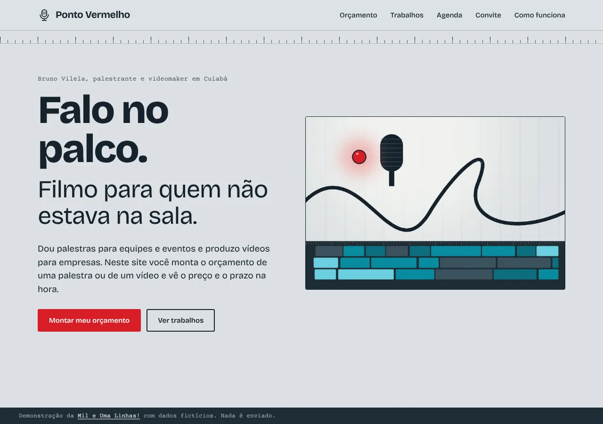

## O que o site faz, em português simples

1. **Orçamento**: você escolhe se quer uma palestra ou um vídeo, mexe nas opções e vê o preço total e o prazo na hora, numa folha de orçamento.
2. **Trabalhos**: um mural com vídeos e palestras já feitas. Você filtra por tipo e abre um visor. O visor é de mentira: a barra anda, mas não existe vídeo.
3. **Agenda**: um calendário com as datas livres. Você escolhe um dia, o período e faz uma pré-reserva de brincadeira.
4. **Convite**: um formulário que confere se você preencheu direito e mostra um resumo na tela.

## Como usar, em passos

1. Abra o site e toque em **Montar meu orçamento**.
2. Escolha **Uma palestra** ou **Um vídeo**. Mude tema, duração, plateia, minutos ou diárias e veja o total mudar na folha.
3. Toque em **Levar este orçamento para o convite** para já preencher o formulário.
4. Em **Trabalhos**, toque em um tipo para filtrar e em um trabalho para abrir o visor. Use Reproduzir, Pausar ou a barra de posição.
5. Em **Agenda**, toque em um dia livre, escolha manhã, tarde ou noite e toque em **Pré-reservar este dia**. Para desfazer, use Cancelar na lista.
6. Em **Me convide**, preencha os campos e toque em **Ver o resumo do convite**. Se faltar algo, o site diz o que corrigir.

## Capturas

| Orçamento | Trabalhos e visor |
|---|---|
| 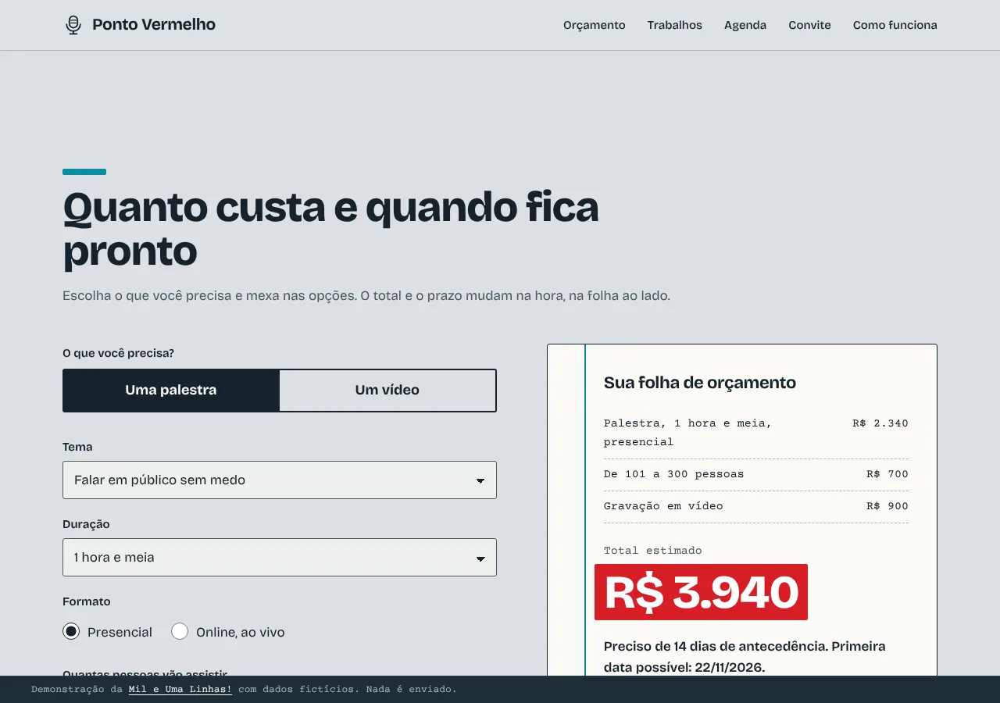 | 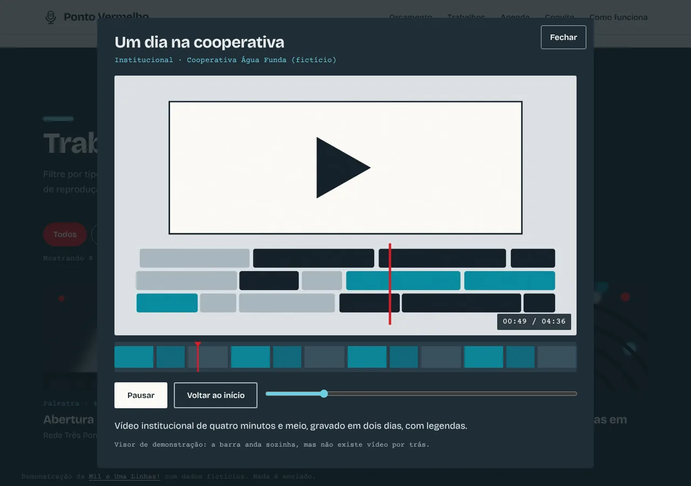 |

| Agenda | Convite com resumo |
|---|---|
| 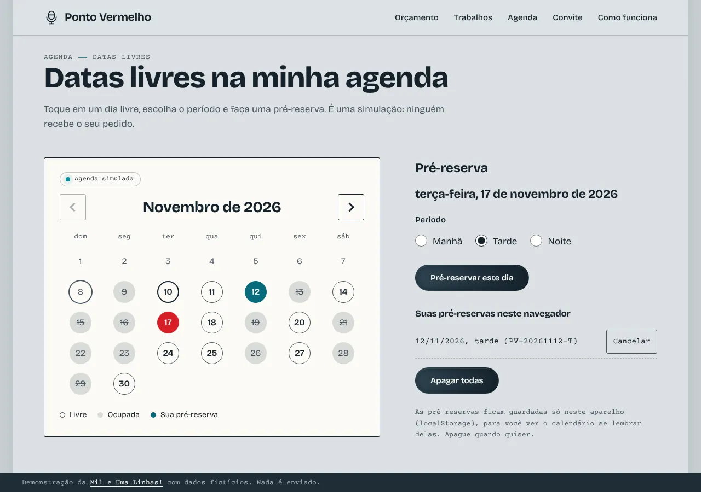 | 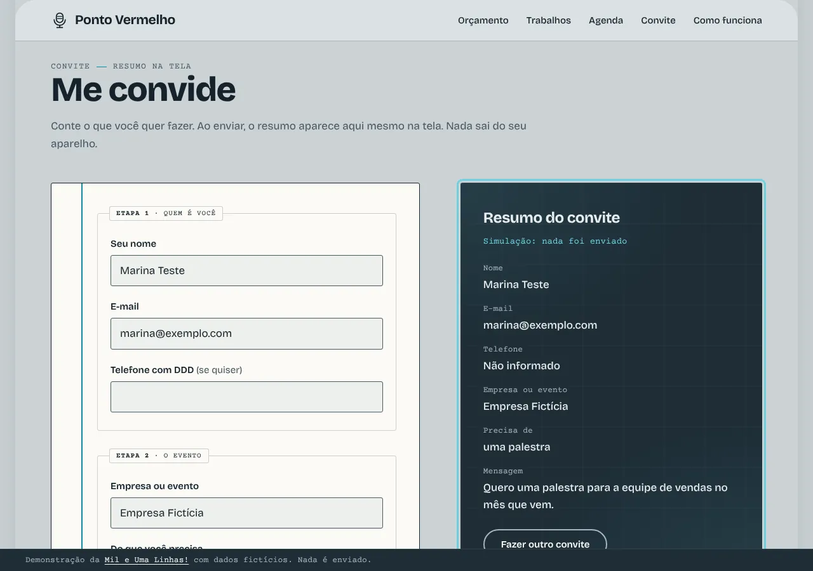 |

No celular:

| Abertura | Orçamento | Mural | Visor | Agenda | Convite |
|---|---|---|---|---|---|
| 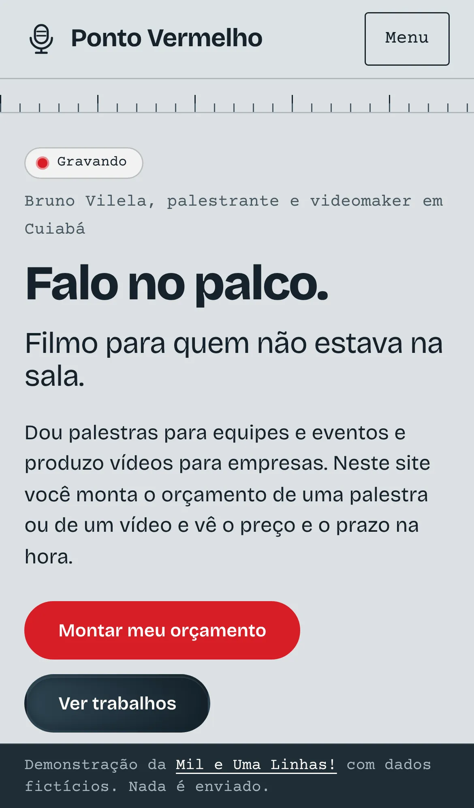 | 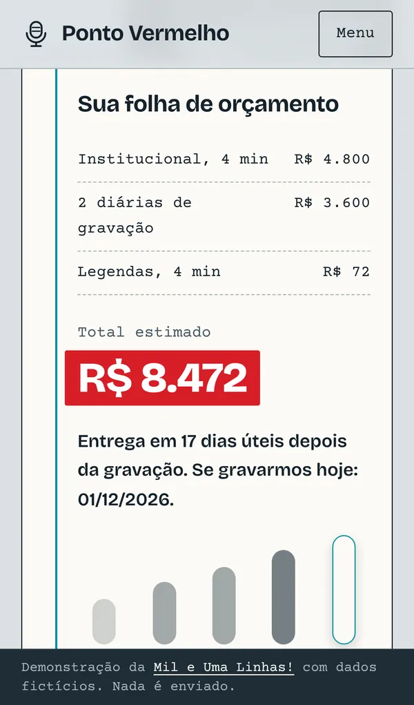 | 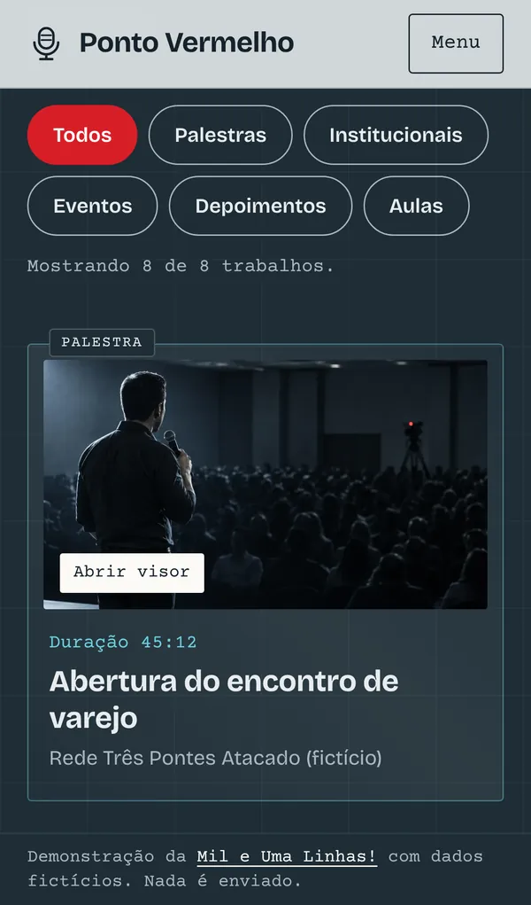 | 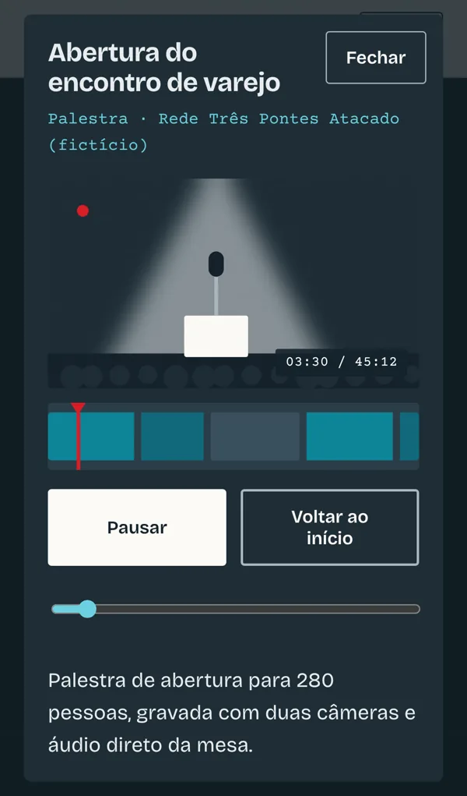 | 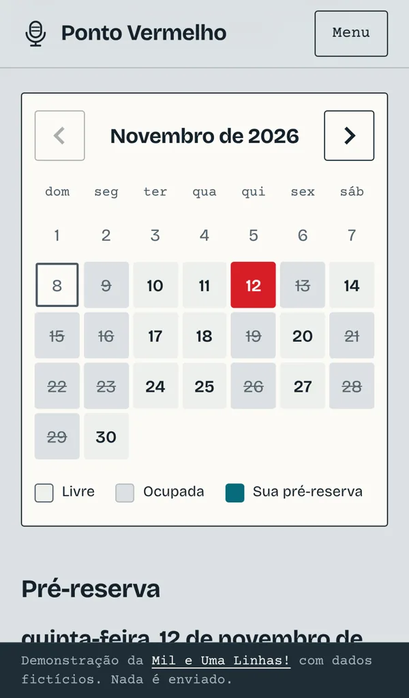 | 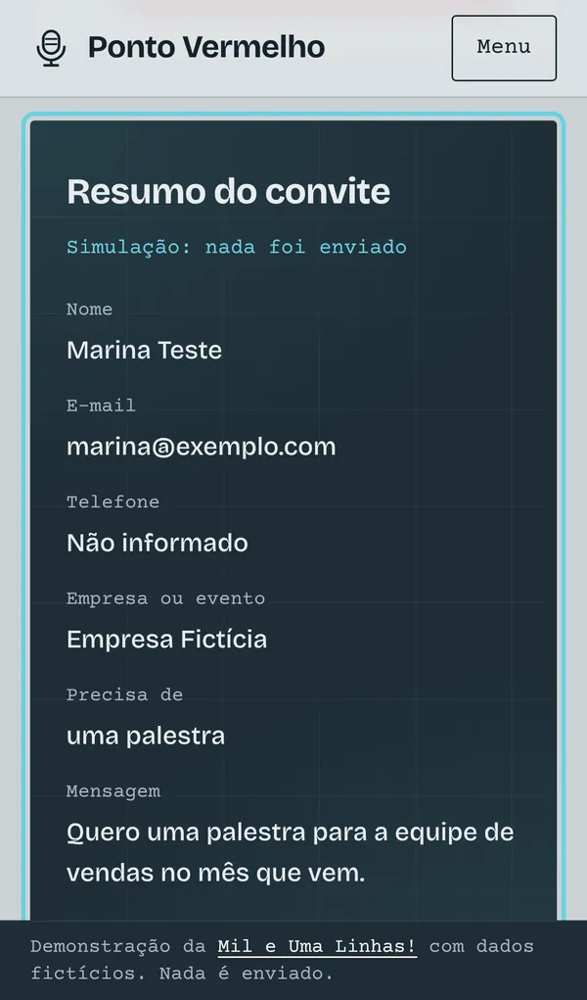 |

## Identidade visual, em resumo

Fugi do palco preto com letreiro neon e da claquete. O site parece **a parede cinza de um estúdio de gravação**, com as peças do dia a dia da produção como interface: a folha de pauta, a régua de tempo do editor de vídeo, a cabeça de leitura da linha do tempo e a luz vermelha de "gravando".

- **Cores**: Parede `#DCE1E3` (fundo), Folha `#FBFAF6` (papel), Tinta `#15222B` (texto), Cabo `#1E2D36` (blocos escuros), Ciano de timeline `#0A8CA0` (apoio) e Tally `#D81E27` (a luz vermelha, só em um lugar por tela).
- **Fontes**: Bricolage Grotesque (títulos e texto) e Courier Prime (tempos e rótulos, como roteiro). As duas são locais e têm licença SIL OFL.
- **Por quê**: o vermelho marca o que está "ao vivo" naquele momento (o total, o filtro ativo, a cabeça de leitura, o dia escolhido). O resto fica quieto.

O estudo completo, com tamanhos, regras e o prompt da foto do hero, está em [docs/identidade.md](docs/identidade.md).

## Como funciona por dentro

Cada função é um pequeno programa que roda no navegador de quem visita. Os preços ficam em uma tabela (`js/dados.js`). Quando uma opção muda, o programa refaz a conta e escreve o resultado. As datas ocupadas da agenda seguem uma regra fixa, então são sempre as mesmas. As pré-reservas ficam guardadas só no aparelho de quem usa.

## Detalhes técnicos

- HTML, CSS e JavaScript puros. Sem framework, sem CDN, sem analytics, sem fonte externa.
- `index.html`: a página. `css/estilo.css`: o visual. `js/dados.js`: preços e trabalhos fictícios. `js/app.js`: orçamento, mural, visor, agenda e convite.
- Orçamento de palestra: `base do tema x fator da duração x fator do formato`, mais acréscimos de plateia, deslocamento (só presencial) e gravação. O prazo é a maior antecedência exigida entre formato, plateia e deslocamento.
- Orçamento de vídeo: `minutos x valor por minuto do tipo + diárias x valor da diária`, mais drone (por diária) e legendas (por minuto). O prazo soma dias úteis de edição e diz a data de entrega "se gravarmos hoje".
- Visor do mural: `<dialog>` com controle deslizante e relógio simulado. Não existe arquivo de vídeo. Com movimento reduzido, o relógio avança de segundo em segundo.
- Agenda: a regra de ocupação depende só da data, então o calendário é sempre igual. Pré-reservas em `localStorage` (chave `pv-prereservas`).
- Imagens: `img/hero.webp` é uma foto gerada por IA no Canva (1620x1080). `tools/gerar-imagens.py` (Pillow) gera só os pôsteres do mural; o script ainda recria um hero provisório, que não deve ser usado no lugar da foto.
- Acessibilidade: contraste AA, foco visível, navegação por teclado, `alt` nas imagens, `lang="pt-BR"`, rótulos em todos os campos e mensagens de erro ligadas aos campos.

## Como rodar

Não precisa instalar nada. Na pasta do site:

```
python3 -m http.server 8318
```

Depois abra http://localhost:8318/ no navegador.

## Testes

Com o servidor acima rodando e o Playwright instalado:

```
node tests/site.cjs
```

O teste abre o site em 1280x900, iPhone 13 e 320 px e confere: erros no console, rolagem horizontal, textos cortados, as quatro funções (valores do orçamento, filtro e visor, pré-reserva, validação do convite) e que nenhum pedido sai para a internet. Para salvar capturas, use `CAPTURAS=pasta node tests/site.cjs`.

## Segurança

Resumo: CSP restritiva, nenhum envio de dados, nenhuma dependência, só as pré-reservas no `localStorage`. A vistoria completa está em [docs/vistoria.md](docs/vistoria.md).

## Quer um site assim?

A [Mil e Uma Linhas!](https://mileumalinhas.com.br) faz sites e sistemas sob medida, de Cuiabá para qualquer lugar.
